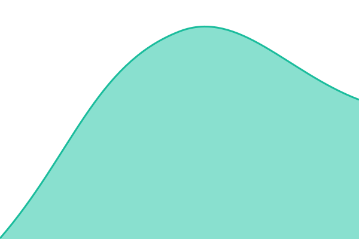
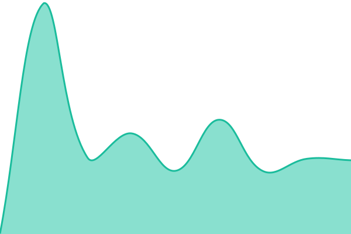
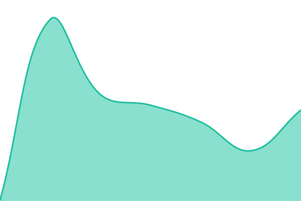
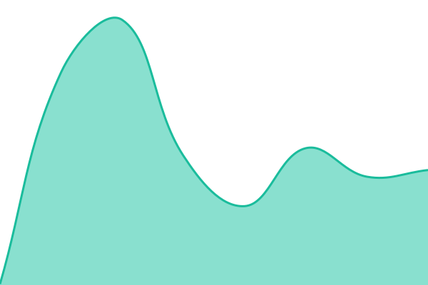
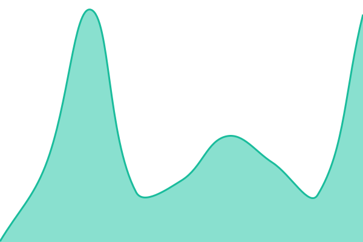

# [📈 Live Status](https://CavemanAppsTeam.github.io/npe-status): <!--live status--> **🟩 All systems operational**

This repository contains the open-source uptime monitor and status page for [CavemanAppsTeam](https://CavemanAppsTeam.github.io/npe-status), powered by [Upptime](https://github.com/upptime/upptime).

With [Upptime](https://upptime.js.org), you can get your own unlimited and free uptime monitor and status page, powered entirely by a GitHub repository. We use [Issues](https://github.com/CavemanAppsTeam/npe-status/issues) as incident reports, [Actions](https://github.com/CavemanAppsTeam/npe-status/actions) as uptime monitors, and [Pages](https://CavemanAppsTeam.github.io/npe-status) for the status page.

<!--start: status pages-->
<!-- This summary is generated by Upptime (https://github.com/upptime/upptime) -->
<!-- Do not edit this manually, your changes will be overwritten -->
<!-- prettier-ignore -->
| URL | Status | History | Response Time | Uptime |
| --- | ------ | ------- | ------------- | ------ |
|  [NPE production homepage](https://northpacificelectric.com/) | 🟩 Up | [npe-production-homepage.yml](https://github.com/CavemanAppsTeam/npe-status/commits/HEAD/history/npe-production-homepage.yml) | 

 146ms
     
 | 

<a href="https://CavemanAppsTeam.github.io/npe-status/history/npe-production-homepage">100.00%</a>
    

|  [NPE Worker homepage](https://north-pacific-electric.gabriel-049.workers.dev/) | 🟩 Up | [npe-worker-homepage.yml](https://github.com/CavemanAppsTeam/npe-status/commits/HEAD/history/npe-worker-homepage.yml) | 

 142ms
     
 | 

<a href="https://CavemanAppsTeam.github.io/npe-status/history/npe-worker-homepage">100.00%</a>
    

|  [Estimate](https://northpacificelectric.com/estimate/) | 🟩 Up | [estimate.yml](https://github.com/CavemanAppsTeam/npe-status/commits/HEAD/history/estimate.yml) | 

 83ms
     
 | 

<a href="https://CavemanAppsTeam.github.io/npe-status/history/estimate">100.00%</a>
    

|  [Services](https://northpacificelectric.com/services/) | 🟩 Up | [services.yml](https://github.com/CavemanAppsTeam/npe-status/commits/HEAD/history/services.yml) | 

 71ms
     
 | 

<a href="https://CavemanAppsTeam.github.io/npe-status/history/services">100.00%</a>
    

|  [Contact](https://northpacificelectric.com/contact/) | 🟩 Up | [contact.yml](https://github.com/CavemanAppsTeam/npe-status/commits/HEAD/history/contact.yml) | 

 86ms
     
 | 

<a href="https://CavemanAppsTeam.github.io/npe-status/history/contact">100.00%</a>
    

<!--end: status pages-->

[**Visit our status website →**](https://CavemanAppsTeam.github.io/npe-status)

## Email alerts (Resend)

Failure webhooks and the daily digest are handled by the Worker in [`relay-worker/`](./relay-worker/) and documented in [`EMAIL.md`](./EMAIL.md). Tokens and recipient emails stay in a local secrets file outside git; sync with `scripts/sync-secrets.ps1`.

## 📄 License

- Powered by: [Upptime](https://github.com/upptime/upptime)
- Code: [MIT](./LICENSE) © [Anand Chowdhary](https://anandchowdhary.com)
- Data in the `./history` directory: [Open Database License](https://opendatacommons.org/licenses/odbl/1-0/)
